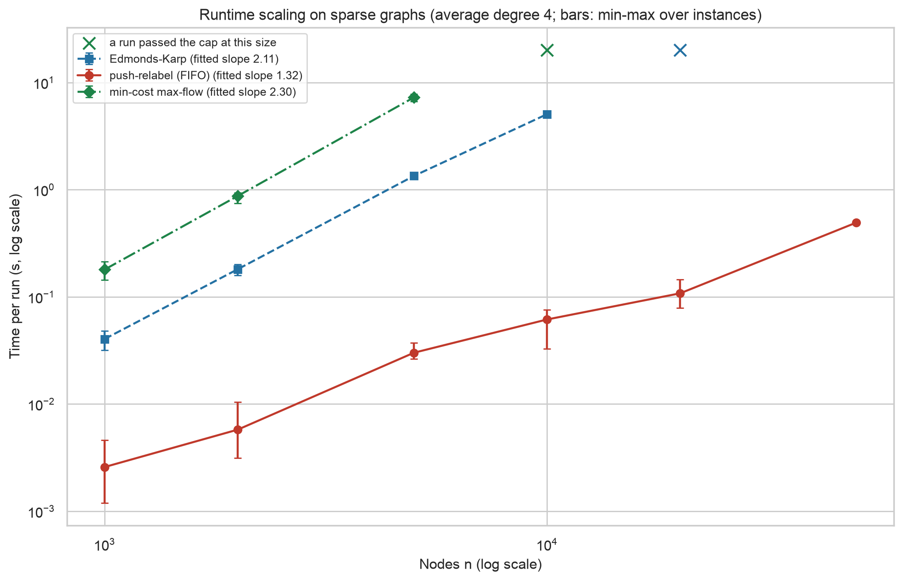
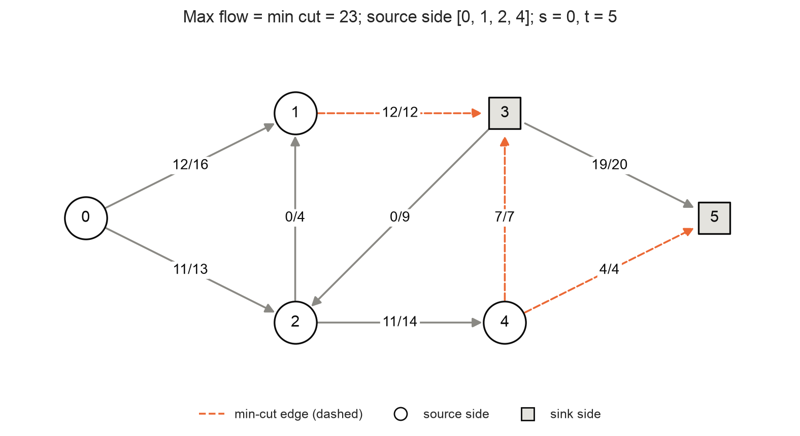
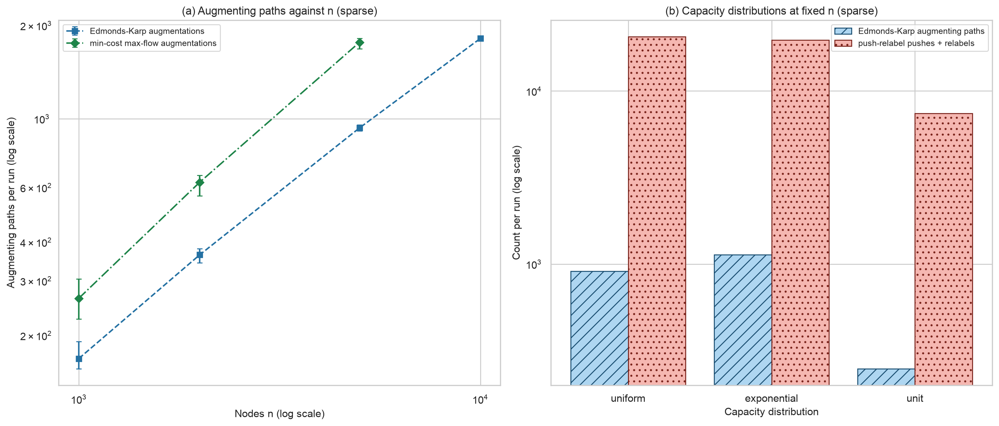
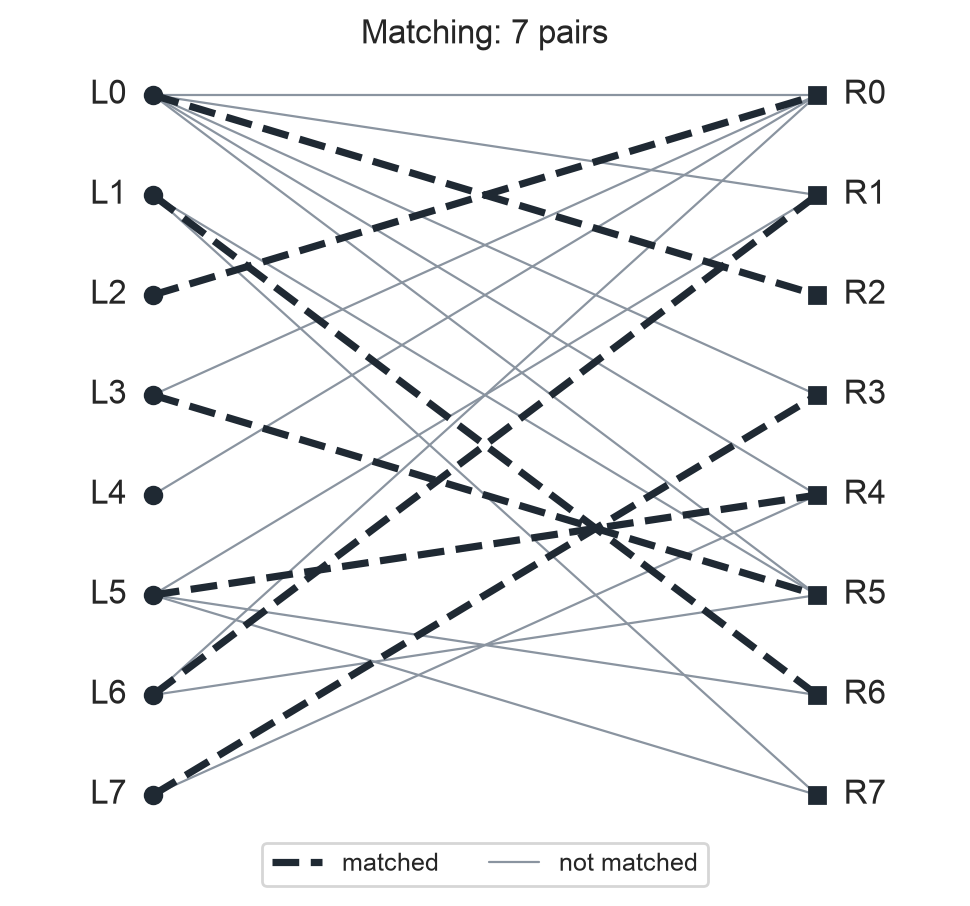
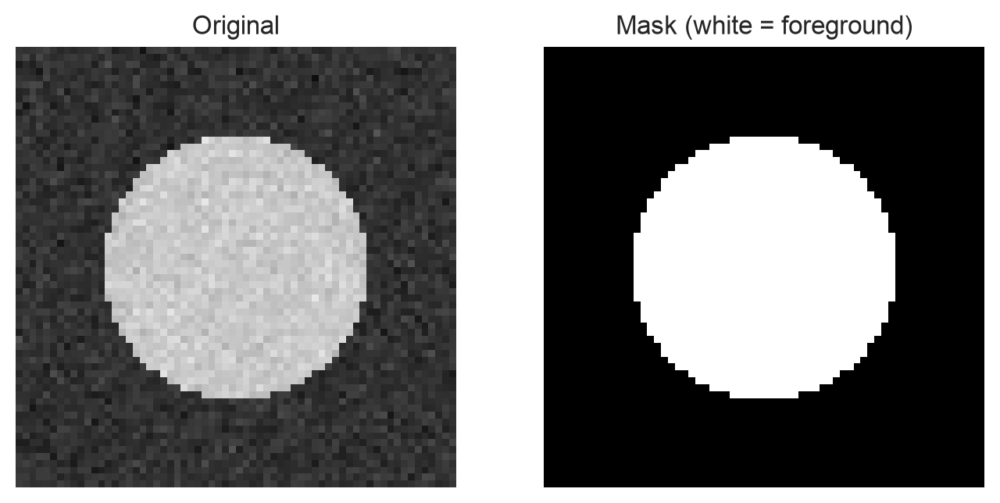
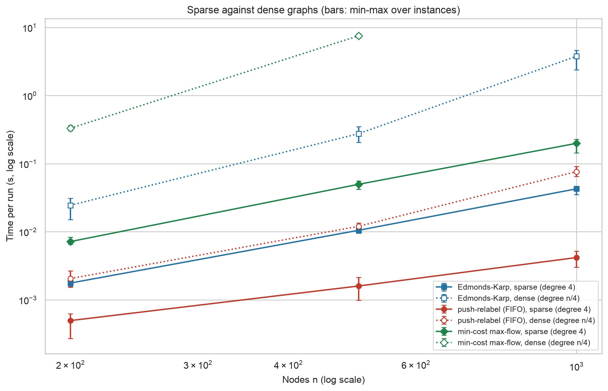
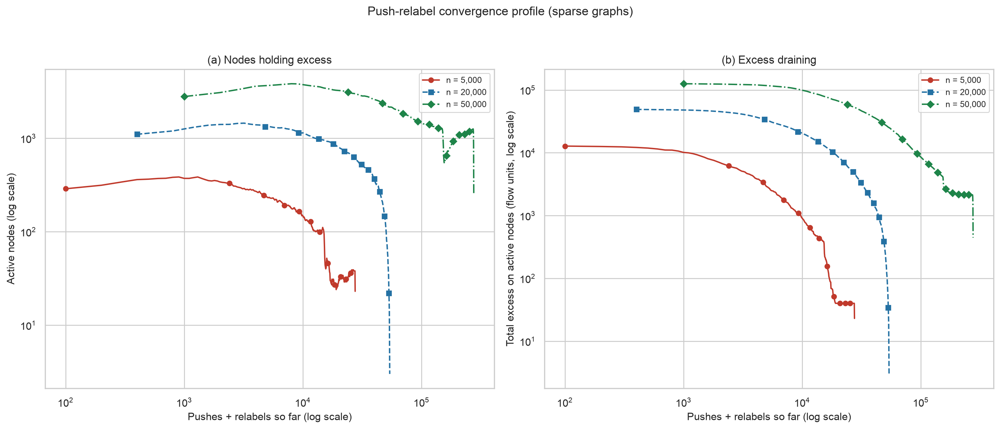
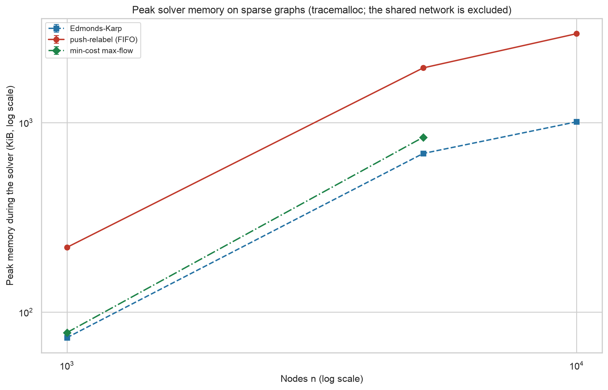

# Week 10 Technical Report - Network Flows, Matching, and Large-Scale Graph Optimization

**Robert Deibel** · CSC 5300 Advanced Algorithms · Concordia University Texas · Fall 2026

## 📎 Complete project repository

### **<https://github.com/RDeibel2025/CTX-Advanced-Algorithms>**

---

## 1. Executive Summary

I built a flow network solver with Edmonds-Karp, FIFO push-relabel and min-cost max-flow, three applications (bipartite matching, image segmentation and scheduling), plots, animations and a command line. Every algorithm and application here works on one residual graph and differs only in what it reads from it. All 155 solver runs passed their checks, and Edmonds-Karp and push-relabel agreed on all 57 instances compared. Push-relabel solved 50,000-node sparse graphs in 0.492 s, while Edmonds-Karp passed the 20-second cap at n = 20,000 and min-cost flow at n = 10,000. Push-relabel's 82.24x lead at n = 10,000 fell to 3.19x on a control with one hub edge per terminal, so that gap depends on the instance family.

## 2. Theory Overview

A flow respects each edge's capacity and conserves flow at every node except the source s and sink t. The residual graph records what can still change: an edge with capacity c carrying flow f leaves c - f forward and f backward. The code stores this in flat arrays, with edge i and its reverse i ^ 1 as a pair, so pushing d units subtracts d from one and adds d to the other.

Optimality is read from the same structure. A flow is maximum exactly when the residual graph has no s-t path, and then the nodes reachable from s form a cut whose capacity equals the flow (CLRS Ch. 24; Amakobe, 2025, Ch. 10). A maximum flow has minimum cost exactly when the residual graph has no negative-cost cycle.

Edmonds-Karp reads the shortest s-t path by BFS, in O(VE²) time (Edmonds & Karp, 1972). Apart from the heuristics below, push-relabel reads only a node's height and excess and never a whole path: it pushes excess downhill and raises a stuck node, in O(V³) for the FIFO variant (Goldberg & Tarjan, 1988). Its gap heuristic lifts nodes that can no longer reach t, and its periodic global relabel resets heights by BFS on the residual graph. Min-cost flow reads the graph with costs, taking the cheapest path each round, and its Johnson potentials keep reduced costs non-negative so Dijkstra applies.

## 3. Methodology

**Layout.** `src/flow_network_solver/` is the instructions' `FlowNetworkSolver/`, under `src/` because the repository holds every week's project, and this report is the instructions' `ch9_report.md`. Outputs are in `benchmarks/results/week10/`. networkx is used only as a cross-check, in the tests and the benchmark's matching study, and for drawing.

**Test conditions.** Apple M2 Max, 64 GB RAM, macOS 14.5 (arm64), CPython 3.12.4. Solvers time themselves with `time.perf_counter`; matching and segmentation times cover the whole application call, including building the network. Peak memory comes from `tracemalloc` in separate, untimed runs, with the network built before tracing starts, so it is solver working memory.

**Data generation.** Random networks have node 0 as source, node n - 1 as sink, integer capacities 1 to 100, costs 1 to 20 and a backbone s-t path. The source and sink each connect to 5% of the nodes, as a super source and super sink would; otherwise a single random node's few edges limit the flow. A control at n = 10,000 cuts this to one hub edge per terminal. Experiments: sparse scaling (average degree 4, n = 1,000 to 50,000), sparse against dense (degree n/4, n = 200 to 1,000), three capacity distributions at n = 5,000, memory at n = 1,000 to 10,000, matching at 50 to 1,000 per side, and segmentation of a seeded disc image at 32x32 and 64x64.

**Seeds and repeats.** The master seed is 42 and every instance comes from `derive_seed(42, experiment, ..., n, rep)`, giving 66 distinct seeds. Each point has 3 instances; memory has one.

**Metrics and validation.** Time, augmenting paths, pushes, relabels and peak memory. Every run on a generated network passes capacity, conservation, residual and flow-value checks. Min-cost flow also passes the negative-cycle check, which does not apply to the others: a maximum flow on a costed graph need not be the cheapest. Applications keep their networks internal, so matching is checked against networkx's maximum matching and for input edges with no node reused, and segmentation by identical masks and cut values from both solvers.

**Size caps.** A timer aborts any run past 20 s (30 s under `tracemalloc`), the run is not reported, and that solver skips larger sizes. Four caps fired: Edmonds-Karp at n = 20,000 sparse, and min-cost flow at n = 10,000 sparse, n = 1,000 dense and n = 10,000 in the memory study. Nothing is projected.

## 4. Algorithm Comparison

| Solver | Reads from the residual graph | Worst case | Fitted slope | Largest n under the cap |
|---|---|---|---|---|
| Edmonds-Karp | shortest s-t path | O(VE²) | 2.11 | 10,000 |
| Push-relabel | local height and excess | O(V³) | 1.32 | 50,000 |
| Min-cost flow | cheapest s-t path | O(VE + F (V + E log V)) for flow F | 2.30 | 5,000 |

Edmonds-Karp's cost is the number of paths times the cost of finding one. Paths grew in step with n (0.168n to 0.187n), and each took longer to find, from 0.24 ms at n = 1,000 to 2.79 ms at n = 10,000. Both factors grow, which gives a slope near 2. Min-cost flow needed more paths (1,764 against 934 at n = 5,000), and each one costs a Dijkstra run instead of a BFS.

Push-relabel needed only 5.53 operations per node and 3.0 global relabels at n = 50,000. The [Edmonds-Karp](https://github.com/RDeibel2025/CTX-Advanced-Algorithms/blob/main/benchmarks/results/week10/ek_animation.gif) and [push-relabel](https://github.com/RDeibel2025/CTX-Advanced-Algorithms/blob/main/benchmarks/results/week10/pr_animation.gif) animations show both on the CLRS network below.

## 5. Applications

**Matching** reads saturated left-to-right edges. Sizes equalled networkx's maximum matching on every instance; at 1,000 per side the mean size was 992.7, in 0.2157 s with Edmonds-Karp and 0.0116 s with push-relabel.

**Segmentation** reads which pixels are still reachable from s, which is the min cut (Boykov & Kolmogorov, 2004). Capacities are scaled by 1,000 and rounded to integers. At 64x64, Edmonds-Karp took 1.3337 s and push-relabel 0.0282 s, with identical masks.

**Scheduling** reads which job-machine edges carry flow. The test instance assigns 3 of 4 jobs and leaves one unassigned, with no machine over capacity.

## 6. Results and Discussion

**The gap depends on the instance family.** Edmonds-Karp's time relative to push-relabel rose from 15.65x at n = 1,000 to 82.24x at n = 10,000, and min-cost flow's reached 240.92x at n = 5,000. In the control with one hub edge per terminal, the flow fell from 23,783.7 to 330.0, Edmonds-Karp needed 32.0 paths instead of 1,815.3, and its time relative to push-relabel fell to 3.19x. Hub edges create many more augmenting paths, each of which costs Edmonds-Karp a BFS, and they cost push-relabel far less. These graphs are easy for push-relabel, so these ratios are not a general result.

**Density.** At n = 1,000, moving from 4,000 to 250,000 edges took Edmonds-Karp from 0.0427 s to 3.7752 s and push-relabel from 0.0042 s to 0.0764 s. Min-cost flow took 7.545 s at n = 500 dense and hit the cap at n = 1,000.

**Capacities.** With unit capacities Edmonds-Karp's 248.0 paths equal the flow of 248.0, since each path carries one unit. Exponential capacities took more paths than uniform (1,129.7 against 910.0) for a smaller flow, so each path carried less on average. Push-relabel used 7,420, 19,702 and 20,573 operations for unit, exponential and uniform capacities.

**Convergence.** At n = 50,000, excess started at 127,669 units, active nodes peaked at 3,834, and excess halved within 8% of the operations and reached a tenth within 30%. In all, 11,440 units (9.0%) could not reach t and went back to s.

**Memory.** Push-relabel used more memory: 2,941 KiB against Edmonds-Karp's 1,008 KiB at n = 10,000 (2.92x).

## 7. Conclusion

One residual graph supported three solvers and three applications, and each read its answer from that graph. For maximum flow alone, push-relabel was the better choice on every family tested, at 2.92x the working memory. Costs change the decision: min-cost flow took 7.2484 s at n = 5,000 against push-relabel's 0.0301 s, and that time is what this solver pays to get the cheapest of the maximum flows instead of any one of them.

## References

- Cormen, T. H., Leiserson, C. E., Rivest, R. L., & Stein, C. (2022). *Introduction to
  Algorithms* (4th ed.). MIT Press. Ch. 24 Maximum Flow.
- Amakobe, M. (2025). *Advanced Computational Algorithms*, Ch. 10 (open textbook).
- Boykov, Y., & Kolmogorov, V. (2004). An experimental comparison of min-cut/max-flow
  algorithms for energy minimization in vision. *IEEE Transactions on Pattern Analysis and
  Machine Intelligence, 26*(9), 1124-1137.
- Edmonds, J., & Karp, R. M. (1972). Theoretical improvements in algorithmic efficiency for
  network flow problems. *Journal of the ACM, 19*(2), 248-264.
- Goldberg, A. V., & Tarjan, R. E. (1988). A new approach to the maximum-flow problem.
  *Journal of the ACM, 35*(4), 921-940.

## AI use

Claude (Claude Code) drafted the code, tests and this report's first draft from a
specification I wrote from the instructions and required reading, including the
cross-checked values the tests assert. Every measurement comes from running the benchmark on
my machine, and every benchmark result in this report is printed from the CSVs by
[`tools/week10_facts.py`](https://github.com/RDeibel2025/CTX-Advanced-Algorithms/blob/main/tools/week10_facts.py).
Full disclosure: [`docs/AI_USE.md`](https://github.com/RDeibel2025/CTX-Advanced-Algorithms/blob/main/docs/AI_USE.md).
