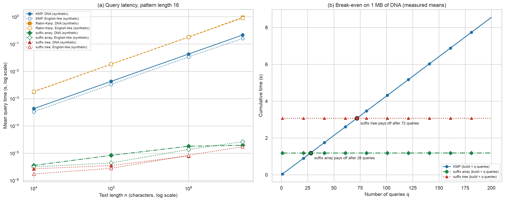
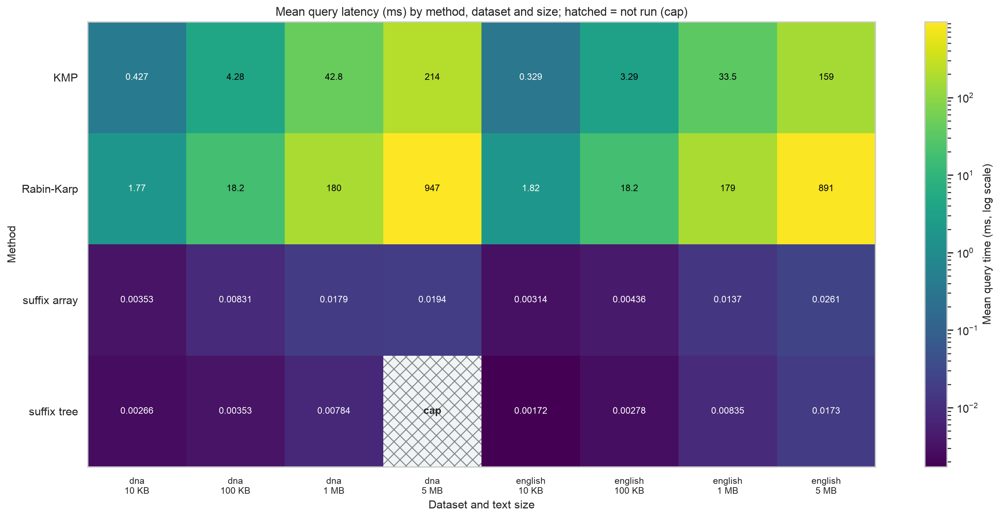
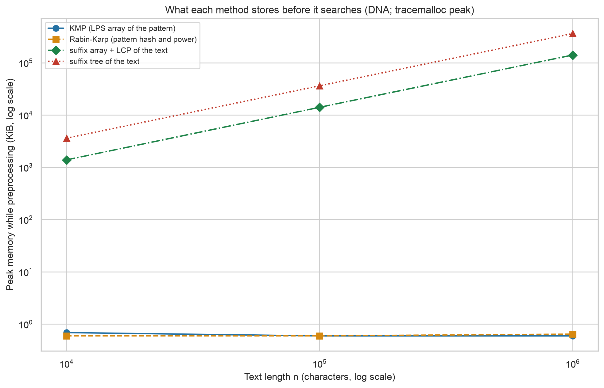
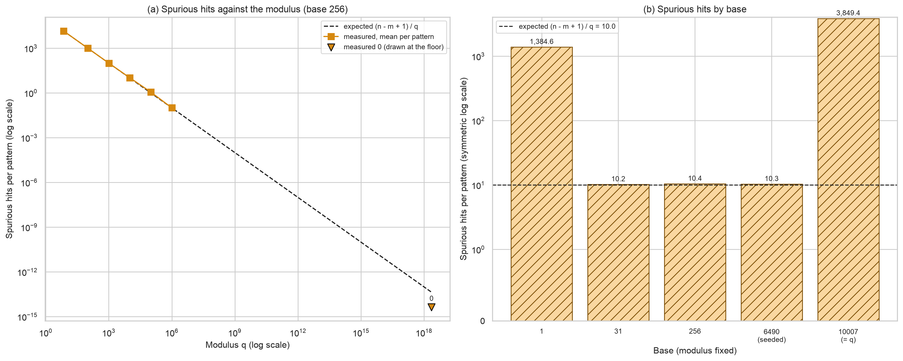
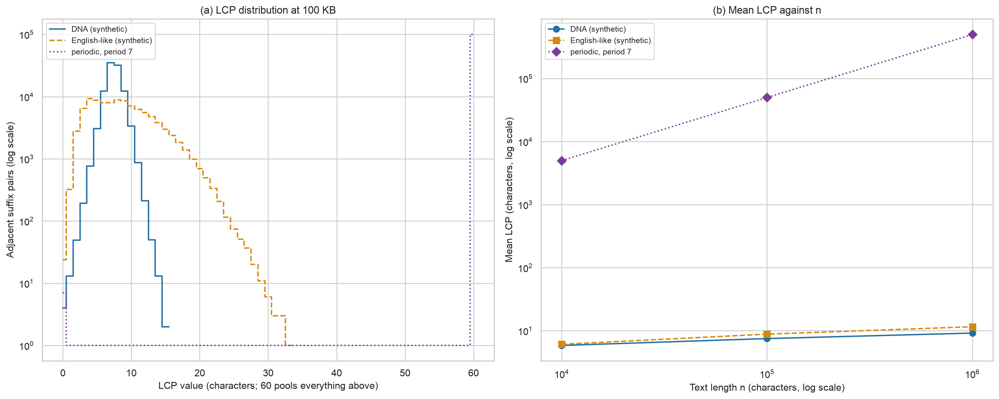

# Week 11 Technical Report - Fast Pattern Matching, Indexing, and Advanced Text Processing

**Robert Deibel** · CSC 5300 Advanced Algorithms · Concordia University Texas · Fall 2026

## 📎 Complete project repository

### **<https://github.com/RDeibel2025/CTX-Advanced-Algorithms>**

---

## 1. Executive Summary

I built a string search engine with Knuth-Morris-Pratt (KMP), Rabin-Karp, a suffix array with LCP array and a suffix tree behind one API, and used it for plagiarism detection, DNA search and autocomplete. This report is organized around what each method stores before it searches, and about which string. KMP and Rabin-Karp keep no index of the text, so they read all of it on every query: 42.76 ms and 180.48 ms on 1 MB of synthetic DNA. The suffix array peaked at 144.0 bytes per character of text and answered in 0.0179 ms after a 1.181 s build, which would pay for itself after 28 queries. The suffix tree answered in 0.0078 ms but peaked at 371.3 bytes per character, and its 5 MB DNA build passed the 20-second cap. On every query, every method returned the same positions as KMP.

## 2. String Matching Complexity

A naive scan compares the pattern at every position, O(nm). KMP stores, for each pattern position, the longest proper prefix that is also a suffix (the LPS array), and falls back on it after a mismatch without rereading the text. That bounds the scan at 2n comparisons and gives O(n + m) (Knuth et al., 1977; CLRS Ch. 32). Rabin-Karp computes one hash per window of the text. The hash is lossy, so every hit is verified: O(n + m) on average, O(nm) when most windows hit, and about (n - m + 1)/q spurious hits per pattern for modulus q (Karp & Rabin, 1987; CLRS Ch. 32).

A suffix array stores the sorted order of every suffix of the text and answers a query by binary search in O(m log n) plus the output (Manber & Myers, 1993). The LCP array holds the shared prefix of each adjacent pair, computed in O(n) (Kasai et al., 2001). A suffix tree stores those shared prefixes as explicit nodes, so a query walks O(m) edges and the tree answers structural questions directly (Gusfield, 1997; Amakobe, 2025, Ch. 11).

## 3. Implementation

`src/string_search_engine/` is the instructions' `StringSearchEngine/`, under `src/` because the repository holds every week's project, and this report is the instructions' `chapter10_report.md`. Every method returns all occurrences, overlapping matches included, as sorted 0-based positions. Rabin-Karp hashes with base 256 and modulus 2^61 - 1 and rolls the hash across windows. The suffix array is built by prefix doubling with `numpy.lexsort`, O(n log² n) in the worst case, with Kasai's LCP in pure Python. The suffix tree is Option A: a compressed trie built in linear time from the suffix array and LCP array of the text plus a terminator. It was chosen over Ukkonen's algorithm because it reuses the suffix array and adds only linear time. `StringSearchEngine` builds indexes on first use and computes `recommend()` from measured times. Tests check all four methods against brute force, including 300 random cases.

## 4. Methodology

**Test conditions and metrics.** Apple M2 Max, 64 GB RAM, macOS 14.5 (arm64), CPython 3.12.4. Index builds are timed once and each query separately with `time.perf_counter`. Character comparisons come from separate counted runs on the first five patterns, and peak memory from separate untimed `tracemalloc` runs. Every query's positions are checked against KMP. In timed size-study runs Rabin-Karp verifies hits with `str.startswith`, which runs in C, while KMP is a pure-Python loop.

**Data generation.** All text is synthetic and seeded; none of it is real genome or English data. DNA is uniform over ACGT. English-like text draws words from a 2,000-word synthetic vocabulary with Zipf weights (s = 1.1), so phrases repeat. Periodic text has period 7, and the collision study uses random lowercase letters. Sizes are 10 KB, 100 KB, 1 MB and 5 MB. Patterns have length 16 (8 for collisions), with 20 per size (5 at 5 MB), half taken from the text and half random.

**Seeds.** The master seed is 42, and every random text and pattern set comes from `derive_seed(42, experiment, ..., n, rep)`.

**Caps.** The suffix tree is built only while one build stays under 20 s. It built 5 MB of English-like text in 18.569 s, but the 5 MB DNA build passed 20 s, so that point is missing. The optional 100 MB dataset was not run. At the measured rates the two 100 MB suffix array builds alone would take about 299 s and 368 s, together well over the benchmark's 5-minute budget, and the suffix tree would need about 37.1 GB.

## 5. Benchmark Results

**Scanning.** KMP's latency grew with a log-log slope of 1.000 at 1.247 comparisons per character on DNA, reaching 213.97 ms at 5 MB. Rabin-Karp took 4.22 times as long as KMP at 1 MB of DNA, although it verified hits in C. With the 61-bit modulus it had no spurious hits on any counted query.

**Indexing.** The suffix array answered in 0.0179 ms at 1 MB and 0.0194 ms at 5 MB, a latency slope of 0.286. That is 2,382.2 times faster than KMP at 1 MB and 11,048.4 times at 5 MB. Its build grew with a slope of 1.166. By the measured means on 1 MB of DNA, the suffix array would repay its build after 28 queries, the tree after 72.

**Memory.** KMP's and Rabin-Karp's preprocessing stayed under 1 KiB at every size. The suffix array peaked at 144.0 bytes per character and the suffix tree 371.3, which is 2.58 times as much. In exchange the tree answered 2.29 times faster than the array at 1 MB of DNA.

**Collisions.** On 100 KB of random letters, measured spurious hits were 0.998 to 1.15 times the expected (n - m + 1)/q for moduli from 7 to 1,000,003, and zero at 2^61 - 1. At q = 10,007, base 1 gave 1,384.6 spurious hits per pattern (138.6 times expected), because the hash becomes a character sum and windows with equal sums collide. Base 10,007 gave 3,849.45 (385.2 times expected), because it is 0 modulo q and the hash keeps only the last character.

**Worst case.** On 100,000 copies of `a` with a pattern of 64, the naive scan and Rabin-Karp each made 6,395,968 comparisons (63.96 per character), in 0.3337 s and 0.2740 s. KMP made 100,063 (1.00 per character) in 0.0072 s. With a final `b`, no window hash matched and Rabin-Karp made no comparisons.

**LCP statistics.** At 1 MB, the mean LCP was 9.159 for DNA, 11.553 for English-like text and 499,993.5 for periodic text. DNA had 499,991,340,825 distinct substrings, essentially all n(n + 1)/2, against 6,999,979 for the periodic text.

## 6. Discussion

**Preprocessing against runtime.** A method that stores nothing about the text pays for the whole text on every query. An index pays once and then reads O(m log n) characters. Here the crossover came at 28 queries, so an index suits repeated search, not a single one.

**Deterministic against randomized.** KMP's bound holds for every input. Rabin-Karp's depends on the hash: with a sound base and modulus its collisions matched theory, and with base 1 or a base divisible by q they rose more than a hundredfold. Verification keeps the results exact, so a bad hash can cost time, not correctness.

**Memory against speed.** The suffix tree stores the most and answers fastest, but it costs 2.58 times the array's peak memory and was the only method to hit the cap.

## 7. Applications

The built applications show the same choice of what to store. Plagiarism detection stores one document's fingerprints and checks the other's against them. On two sentences with the same words in a different order it shared 9 of 11 word 3-shingles (score 0.8182), while 2-shingles scored 1.0, so short shingles miss reordering. On the two shipped documents it found 29 of 204 shingles shared (score 0.1422), no spurious fingerprint matches, and a 96-character longest common substring. DNA search indexes each sequence of the synthetic genome with a suffix array and suffix tree, because in bioinformatics a genome stays fixed and is queried many times; it also finds one-mismatch matches. Autocomplete stores the prefix structure of the vocabulary in a radix trie; six recorded queries raised "careful" from weight 2 to 8 and to the top. The same choices appear in search engines, which index text once for many queries, in NLP near-duplicate detection, and in compiler lexers, which match keywords with automata like KMP's.

## 8. Conclusion

What a method stores before it searches decides when it is worth using. For one query on 1 MB of synthetic DNA, KMP's 42.76 ms beats the suffix array's 1.181 s build. From the 28th query on, the suffix array is cheaper in total, at a peak of 144.0 bytes of memory for every character of text.

## References

- Amakobe, M. (2025). *Advanced Algorithms: Concepts, Complexity, and Applied Projects*,
  Ch. 11, String Algorithms.
- Cormen, T. H., Leiserson, C. E., Rivest, R. L., & Stein, C. (2022). *Introduction to
  Algorithms* (4th ed.). MIT Press. Ch. 32, String Matching.
- Gusfield, D. (1997). *Algorithms on Strings, Trees, and Sequences*. Cambridge University
  Press.
- Karp, R. M., & Rabin, M. O. (1987). Efficient randomized pattern-matching algorithms. *IBM
  Journal of Research and Development, 31*(2), 249-260.
- Kasai, T., Lee, G., Arimura, H., Arikawa, S., & Park, K. (2001). Linear-time
  longest-common-prefix computation in suffix arrays and its applications. In
  *Combinatorial Pattern Matching (CPM 2001)*, LNCS 2089, 181-192.
- Knuth, D. E., Morris, J. H., & Pratt, V. R. (1977). Fast pattern matching in strings.
  *SIAM Journal on Computing, 6*(2), 323-350.
- Manber, U., & Myers, G. (1993). Suffix arrays: A new method for on-line string searches.
  *SIAM Journal on Computing, 22*(5), 935-948.

## AI use

Claude (Claude Code) drafted the code, tests and this report's first draft from a
specification I wrote from the instructions and required reading, including the
brute-force anchor values the tests assert. Every measurement comes from running the
benchmark on my machine; every benchmark result in this report is printed from the CSVs by
[`tools/week11_facts.py`](https://github.com/RDeibel2025/CTX-Advanced-Algorithms/blob/main/tools/week11_facts.py),
and the application results come from `examples/week11_demo.py`. Full disclosure:
[`docs/AI_USE.md`](https://github.com/RDeibel2025/CTX-Advanced-Algorithms/blob/main/docs/AI_USE.md).
