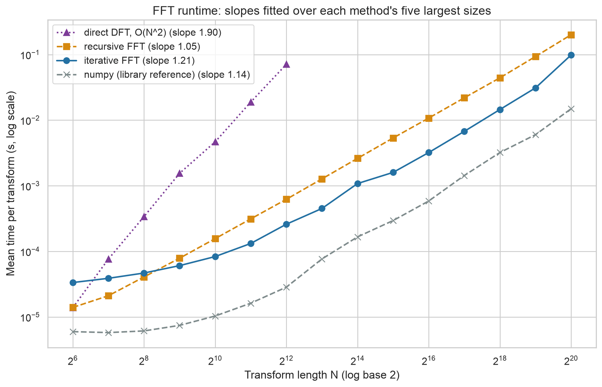
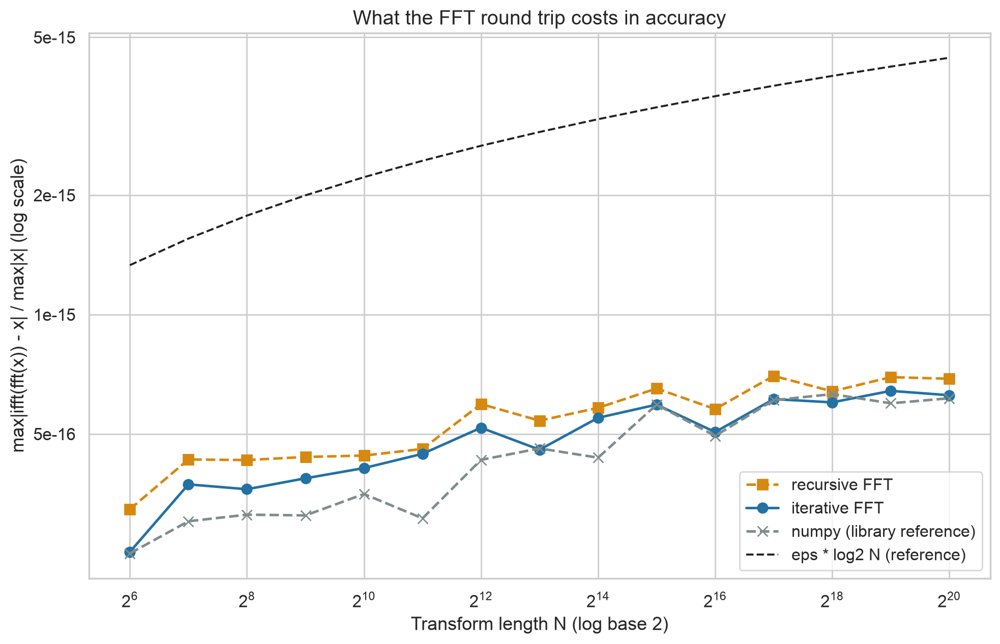
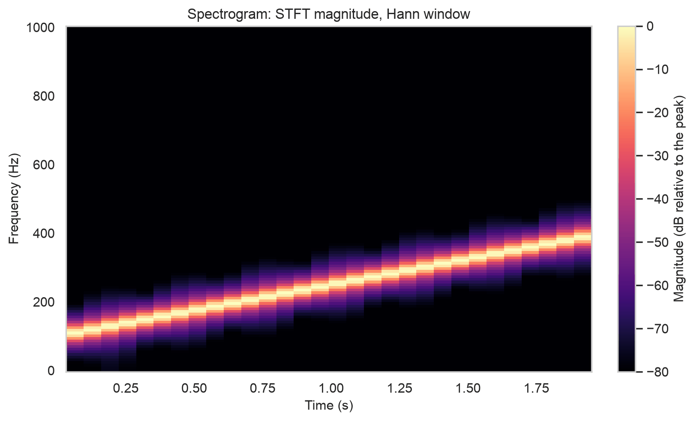
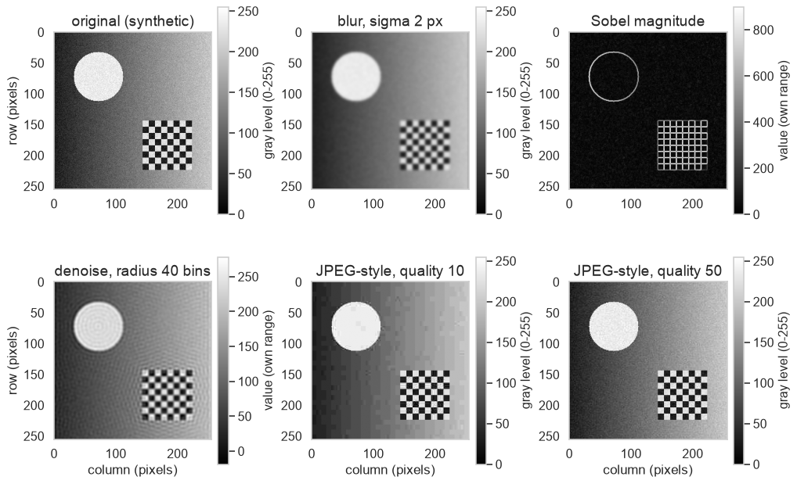
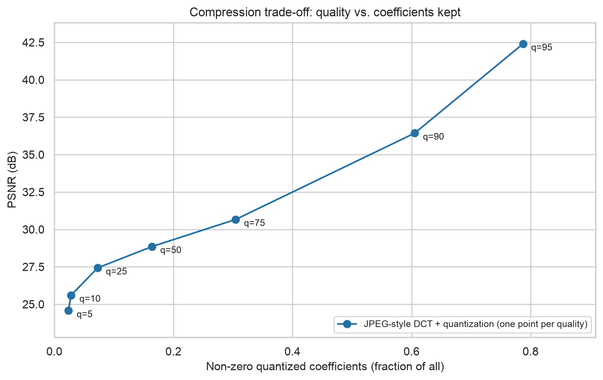
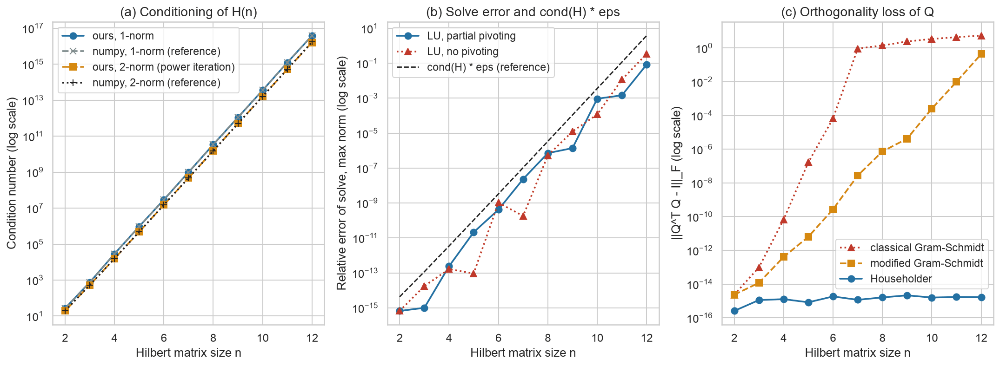
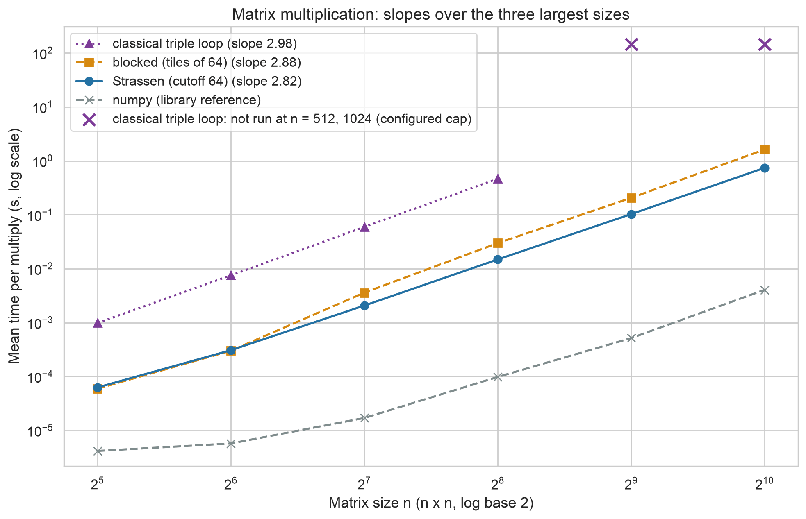

# Week 12 Technical Report - Fast Transforms, Numerical Stability, and Signal and Image Processing

**Robert Deibel** · CSC 5300 Advanced Algorithms · Concordia University Texas · Fall 2026

## 📎 Complete project repository

### **<https://github.com/RDeibel2025/CTX-Advanced-Algorithms>**

---

## 1. Executive Summary

I built an FFT analyzer: radix-2 Cooley-Tukey FFTs, three matrix multiplies, pivoted LU, three QR methods, and signal, image and audio modules. The transform, filter, compression and factorization modules follow one pattern: move the problem to where it is easy, do the easy thing, move back, and measure what the round trip cost. At N = 4,096 the iterative FFT ran 274 times faster than the direct DFT; at N = 2^20 its relative round-trip error was 6.26e-16. On Hilbert matrices up to n = 12 the pivoted solve's error stayed below cond(H)·eps, and classical Gram-Schmidt's orthogonality loss reached order one by n = 7 while Householder's stayed below 2.2e-15. Quality 50 compression kept 16.4% of the DCT coefficients at 28.86 dB.

## 2. Numerical Algorithm Theory

The DFT evaluates a degree N - 1 polynomial at the N complex roots of unity, costing O(N^2). Cooley-Tukey splits the input into even and odd samples, solves two half-size transforms and combines them with N/2 twiddle multiplications: T(N) = 2T(N/2) + O(N) = O(N log N) (Cooley & Tukey, 1965; CLRS Ch. 30). Since convolution in time is pointwise multiplication in frequency, convolving two signals takes two FFTs, a multiply and an inverse FFT, zero-padded for linear convolution (CLRS Ch. 30; Amakobe, 2025, Ch. 12).

Linear algebra makes the same move. LU with partial pivoting factors PA = LU once; each solve is then two O(n^2) triangular substitutions (CLRS Ch. 28). Strassen multiplies 2 x 2 block matrices with seven products instead of eight, O(n^(log2 7)) = O(n^2.81) (Strassen, 1969). The FFT's worst-case rounding error is a small multiple of eps·log2 N (Higham, 2002); a backward-stable solve has relative error up to about cond(A)·eps; and how Q was built decides how orthogonal it stays (Golub & Van Loan, 2013).

## 3. Methodology

**Test conditions.** Apple M2 Max, 64 GB RAM, macOS 14.5 (arm64), CPython 3.12.4, numpy 2.5.2 (pinned in `requirements.txt`), timed with `time.perf_counter`. FFT and multiply sizes get an untimed warm-up and 3 timed runs (multiplies above n = 256 get one; numpy's `@` always five). A size is capped if a run passes 20 s or, for multiplies, if its n^3 prediction does; neither fired. The classical triple loop is capped above n = 256 by configuration.

**Data and seeds.** The master seed is 42. FFT inputs (real and imaginary parts standard normal) come from numpy's `default_rng(derive_seed(42, "fft", N, 0))`, N = 2^6 to 2^20 (the DFT to 2^12), and standard normal matrices from `derive_seed(42, "matmul", n, 0)`, n = 32 to 1,024: the CSV's 21 distinct seeds. Power iteration starts from `derive_seed(42, "week12", "cond2_power")`. Stability uses Hilbert matrices, n = 2 to 12. `make_test_scene`, `make_example_wav` and `make_series` build the synthetic image, WAV (440 Hz and 3,000 Hz tones) and daily series, with noise from `derive_seed(42, label, "noise")`, label "test_scene", "tone_noise" or "series". The filter signal is sin(2 pi 50t) + 0.5 sin(2 pi 120t), 1,000 samples at 1 kHz.

**Metrics.** Errors against numpy are max|a - b| / max|b|. Solve error is max|x - 1| for H x = H·1; ratios to cond(H)·eps use numpy's 2-norm cond. PSNR is 10 log10(255^2 / MSE); the nonzero ratio is the fraction of quantized DCT coefficients that are non-zero.

**Naming and references.** `src/fft_analyzer/` is the instructions' `FFTAnalyzer/fft_analyzer/`, and this report is their `docs/chapter11_report.md`, renamed because this is Chapter 12 in Amakobe (2025). Inside the package no library FFT or solver is called, only numpy array arithmetic (including `@` for the DCT). numpy and scipy appear only as test cross-checks and labelled benchmark reference rows (`np.fft.fft`, `np.fft.ifft`, `@`, `np.linalg.cond`). The largest FFT or multiply error against numpy was 9.8e-15.

## 4. FFT and Spectral Analysis

Over each method's five largest sizes, the DFT's log-log slope was 1.90, close to the predicted 2, and the recursive FFT's 1.05. The iterative FFT's was 1.21 because its time rose from 31.1 ms at 2^19 to 98.7 ms at 2^20; I did not measure why. The recursive FFT took 200.8 ms at 2^20 but was faster up to N = 2^8.

The iterative FFT's relative round-trip error, max|ifft(fft(x)) - x| / max|x|, ranged from 2.52e-16 to 6.42e-16, and its ratio to eps·log2 N from 0.141 to 0.240; the recursive ratio ranged from 0.155 to 0.277. 

In the signal demo's 100 to 400 Hz chirp (2 kHz, 2 s), the dominant frequency rose from 109.4 Hz to 390.6 Hz and never fell after 3-frame smoothing.

Filter energy left is |Y(f)|^2 / |X(f)|^2 at the removed tone's DFT bin. A low-pass at 80 Hz left 9.8e-6 of the 120 Hz energy over the full record and 2.6e-10 on the interior (50 samples dropped at each end), where the tests assert 1e-6. A high-pass left 5.0e-7 (full record) and 3.9e-12 (interior) of the 50 Hz energy. The filter zero-pads the record to 1,024 samples, and the gap between full record and interior is consistent with ringing from that jump to zero. The animations show a low-pass [cutoff sweep](https://raw.githubusercontent.com/RDeibel2025/CTX-Advanced-Algorithms/main/benchmarks/results/week12/filtering.gif) on the same signal and the [butterfly stages](https://raw.githubusercontent.com/RDeibel2025/CTX-Advanced-Algorithms/main/benchmarks/results/week12/fft_stages.gif) of a 16-point FFT.

## 5. Image and Audio Results

Blur and the two Sobel gradients are circular convolutions computed through the [2-D FFT](https://raw.githubusercontent.com/RDeibel2025/CTX-Advanced-Algorithms/main/benchmarks/results/week12/fft2_heatmap.png); Sobel returns their magnitude. The tests match the FFT convolution to `scipy.ndimage.convolve` and the blur to `scipy.ndimage.gaussian_filter`, in wrap mode, within 1e-9. Denoising keeps a disc of low frequencies. Compression shifts each 8 x 8 block by -128, applies the DCT, divides by the JPEG luminance table (Wallace, 1992) scaled by quality the IJG way, rounds, multiplies back and inverts. With no entropy coding, the nonzero ratio stands in for file size.

Quality 5 kept 2.36% of the coefficients at 24.57 dB, quality 50 kept 16.41% at 28.86 dB, and quality 95 kept 78.72% at 42.40 dB.

In the audio demo, a 1,000 Hz low-pass on the synthetic WAV kept 0.999997 of the 440 Hz peak and 0.000047 of the 3,000 Hz peak ([output WAV](https://raw.githubusercontent.com/RDeibel2025/CTX-Advanced-Algorithms/main/benchmarks/results/week12/audio_filtered.wav)). On a 364-day synthetic series the detrended spectrum peaked at bin 52, a period of 7.0 days, and the first autocorrelation peak was at lag 7.

## 6. Stability Considerations

My 1-norm and power-iteration 2-norm condition numbers matched numpy's within a relative 3.7e-5 through n = 10, and within 0.58% and 7.0% at n = 12, where both exceed 1/eps. The pivoted solve's error grew from 6.66e-16 at n = 2 to 8.36e-2 at n = 12, between 0.0086 and 0.26 of cond(H)·eps. Without pivoting the error was smaller at five sizes, equal at n = 2 and larger at five, reaching 3.40e-1 at n = 12. Elimination without pivoting is stable on symmetric positive definite matrices such as H (Golub & Van Loan, 2013). On the test case [[1e-20, 1], [1, 1]] x = [1, 2], the solve returns [0, 1] without pivoting and [1, 1] with it.

Classical Gram-Schmidt's orthogonality loss ||QᵀQ - I||_F reached 0.927 at n = 7 and 5.48 at n = 12. Modified Gram-Schmidt's reached 0.439 at n = 12, between 0.039 and 0.55 of cond(H)·eps throughout. Householder's never exceeded 2.15e-15.

## 7. Benchmark Results

Over the three largest sizes, the classical triple loop's slope was 2.98 (n = 64 to 256; 0.468 s at 256), blocking's 2.88 and Strassen's 2.82 (n = 256 to 1,024); log2 7 is 2.81. The blocked multiply, which builds each 64 x 64 tile product from rank-1 numpy outer-product updates, was 15.7 to 25.0 times faster than the classical loop at n = 32 to 256 and took 1.623 s at n = 1,024, where Strassen took 0.742 s. Strassen hands blocks of 64 or less to the blocked multiply, so their errors match at n = 32 and 64; at n = 1,024 Strassen's was 16 times blocking's (9.8e-15 against 6.1e-16), which its weaker worst-case bound allows (Higham, 2002). numpy's `@` (library reference) took 0.0041 s at n = 1,024.

## 8. Discussion

The methods differ in how much error they amplify. The pivoted solve's error grew with cond(H) but stayed below cond(H)·eps, and Strassen's reached 16 times blocking's. Householder kept Q orthogonal at every tested condition number, while classical Gram-Schmidt's loss reached order one at n = 7, where cond(H) is 4.75e8. Compression, like filtering, discards information on purpose, and its quality setting chooses how much.

## 9. Conclusion

The FFT turned O(N^2) work into O(N log N) with a relative round-trip error below 7.1e-16. LU, QR and the DCT each move a problem to where the work is simple; the measured price was error below cond(H)·eps for the pivoted solve and modified Gram-Schmidt, almost none for Householder, and a chosen loss of detail for compression.

## References

- Amakobe, M. (2025). *Advanced Algorithms: Concepts, Complexity, and Applied Projects*,
  Ch. 12.
- Cooley, J. W., & Tukey, J. W. (1965). An algorithm for the machine calculation of complex
  Fourier series. *Mathematics of Computation, 19*(90), 297-301.
- Cormen, T. H., Leiserson, C. E., Rivest, R. L., & Stein, C. (2022) [CLRS]. *Introduction to
  Algorithms* (4th ed.). MIT Press. Ch. 28, Matrix Operations, and Ch. 30, Polynomials and
  the FFT.
- Golub, G. H., & Van Loan, C. F. (2013). *Matrix Computations* (4th ed.). Johns Hopkins
  University Press.
- Higham, N. J. (2002). *Accuracy and Stability of Numerical Algorithms* (2nd ed.). SIAM.
  Ch. 23, Fast Matrix Multiplication, and Ch. 24, The Fast Fourier Transform and
  Applications.
- Strassen, V. (1969). Gaussian elimination is not optimal. *Numerische Mathematik, 13*(4),
  354-356.
- Wallace, G. K. (1992). The JPEG still picture compression standard. *IEEE Transactions on
  Consumer Electronics, 38*(1), xviii-xxxiv.

## AI use

Claude (Claude Code) drafted the code, tests and this report's first draft from a
specification I wrote from the instructions and required reading, including the anchor
values the tests assert. Every benchmark measurement comes from running the benchmark on my machine;
every benchmark result in this report is printed from the CSV by
[`tools/week12_facts.py`](https://github.com/RDeibel2025/CTX-Advanced-Algorithms/blob/main/tools/week12_facts.py),
and the application results come from the three demos in `examples/`. Full disclosure:
[`docs/AI_USE.md`](https://github.com/RDeibel2025/CTX-Advanced-Algorithms/blob/main/docs/AI_USE.md).
