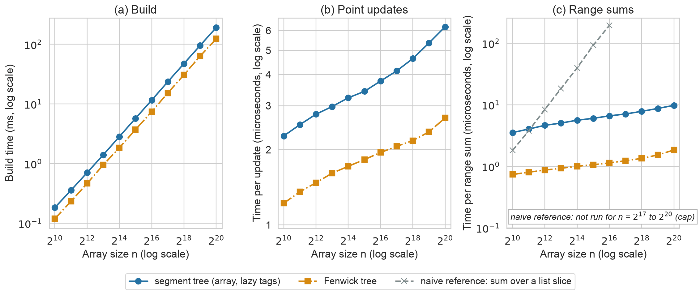
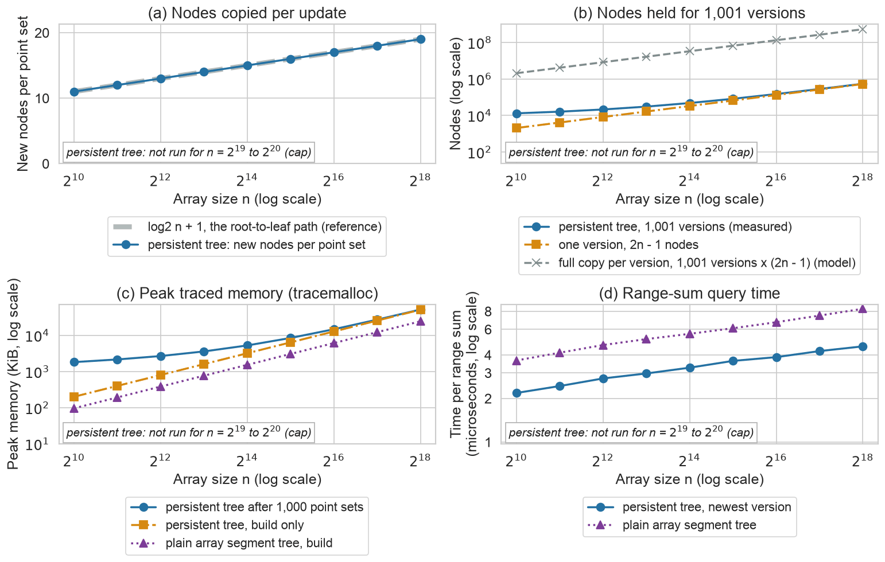
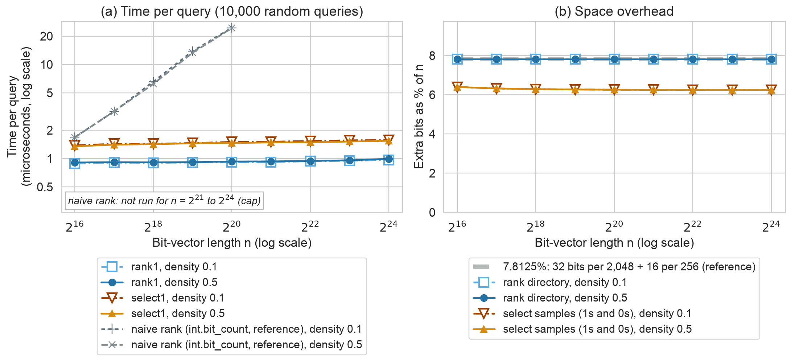
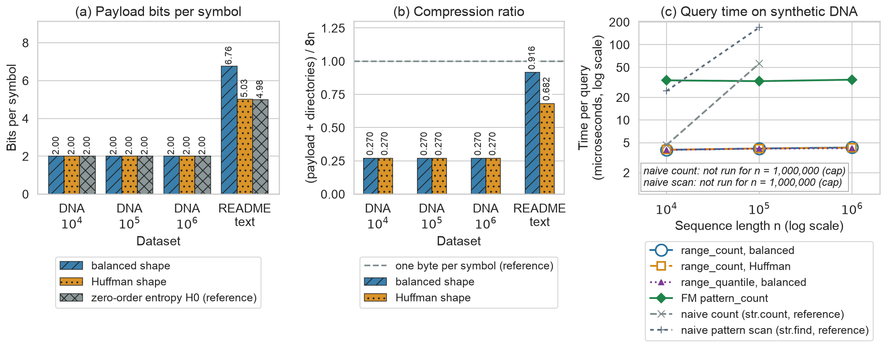
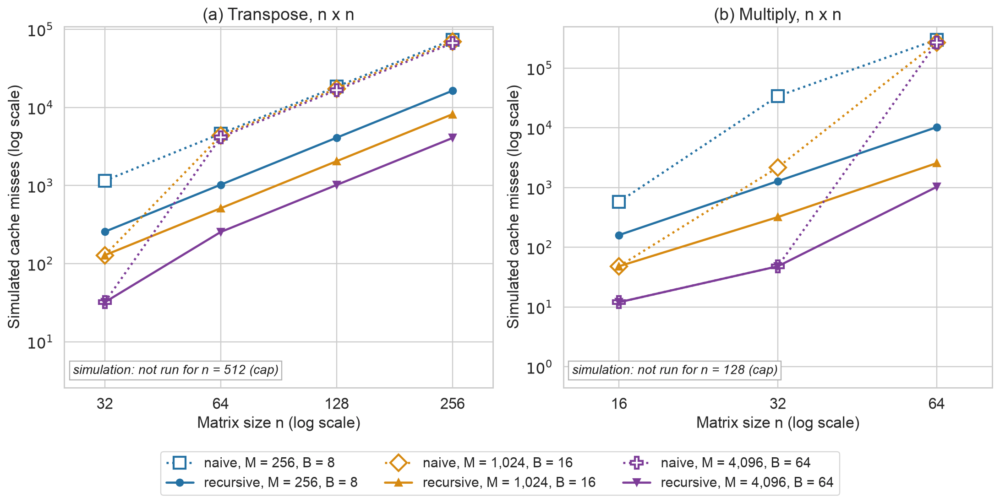
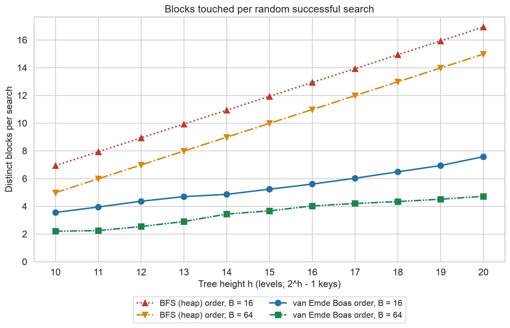
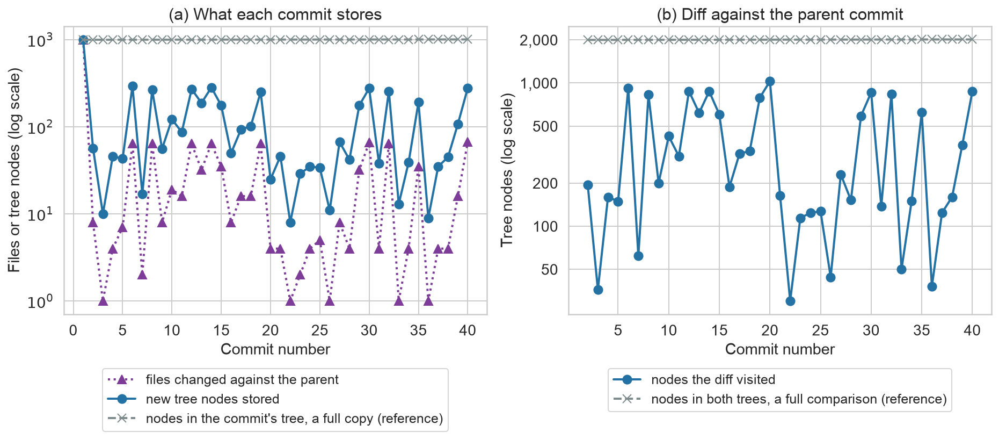

# Week 13 Technical Report - Advanced Data Structures

**Robert Deibel** · CSC 5300 Advanced Algorithms · Concordia University Texas · Fall 2026

## 📎 Complete project repository

### **<https://github.com/RDeibel2025/CTX-Advanced-Algorithms>**

---

## 1. Executive Summary

I built `src/advds/`, a package of range-query, persistent, succinct and cache-oblivious structures with three applications. Each structure halves a different axis of the problem, and this report measures what the halving costs and what it returns on that axis. Fenwick range sums stayed under 2 microseconds up to n = 2^20; 1,001 persistent versions of a 2^18 array held 1.04 times one version's nodes; rank stayed under 1 microsecond over a 256-fold size range for 7.8125% extra bits; and the van Emde Boas layout touched 0.315 to 0.512 times BFS's blocks.

## 2. Overview of Advanced Data Structures

Per axis: positions, about 2n nodes for O(log n) operations; versions, log2 n + 1 nodes per point set; bits, 7.8125% for O(1) rank; the alphabet, ceil(log2 sigma) bits per symbol for O(log sigma) queries, or about H0 with the Huffman shape; memory, recursion for misses near the block count.

The segment tree is an augmented tree (Cormen et al., 2022, Ch. 17), the Fenwick tree is Fenwick's (1994), and path copying follows Driscoll et al. (1989). Constant-time rank is Jacobson's (1989), the wavelet tree Grossi et al.'s (2003), and FM backward search Ferragina and Manzini's (2000). Cache-oblivious design is from Frigo et al. (1999).

## 3. Methodology

**Test conditions.** Apple M2 Max, 64 GB RAM, macOS 14.5, CPython 3.12.4, numpy 2.5.2 (pinned). Each timed method gets one untimed warm-up and five timed calls per size (`time.perf_counter`, garbage collection paused). Time per operation is mean call time over operations per call (10,000 queries or updates; 1,000 point sets or patterns). A 20 s per-call cap never fired (slowest mean 1.95 s).

**Sizes and caps.** Trees ran n = 2^10 to 2^20 (naive sum to 2^16, persistent tree to 2^18), bit vectors 2^16 to 2^24 (`int.bit_count` to 2^20), DNA 10^4 to 10^6 (naive scans to 10^5), transpose n = 32 to 512 and multiply 16 to 128 (simulated to 256 and 64), layouts h = 10 to 20. These limits are the CSV's 38 capped rows of 477, left blank.

**Data and seeds.** Master seed 42; inputs come from `derive_seed(42, experiment, n, ...)` (numpy `default_rng` or Python `random`). Arrays hold integers 0 to 999, matrices -9 to 9; bit densities are 0.5 and 0.1. DNA is synthetic, `synthetic_dna(n, seed)`, uniform over A, C, G and T; the real-dataset option was not used. The text sample is this repository's README.md at the benchmark run (87,829 characters, 101 symbols); the version history, 1,000 synthetic files over 40 commits.

**Metrics.** Misses are simulated because CPython's per-access interpreter overhead can hide cache effects: each address trace (base case 1, row-major layout) runs through a fully associative LRU cache of M words in blocks of B. Blocks per search averages distinct B-node blocks over 10,000 random searches. Bits per symbol is wavelet payload over n; compression ratio adds rank directories and divides by 8n bits; H0 is zero-order entropy; memory is the `tracemalloc` peak; slopes are log-log fits. Library calls other than `np.lexsort` and hashing appear only as checks and labelled references.

**Naming.** `src/advds/` is the instructions' `AdvancedDataStructures/advds/`; this report is their `docs/chapter12_report.md`, renamed because this is Chapter 13 in Amakobe (2025).

## 4. Tree-Based Range Queries

The segment tree is an array over the next power of two with sum, min and max per node and lazy add tags. The Fenwick tree stores at index i the sum of the lowbit(i) elements ending there; two give range add with range sum.

## 5. Persistent Structures

A point set copies one root-to-leaf path; range add leaves permanent tags, so no node changes after creation. The persistent map is a treap with stable-hash priorities, so its shape depends only on its keys, and a blake2b hash per node over key, value and children.

## 6. Succinct and Compressed Structures

Rank keeps a 32-bit count per 2,048-bit superblock and a 16-bit count per 256-bit block plus an 8-bit popcount table, so it is O(1); select samples every 512th one and zero and is O(1) apart from a bounded binary search. The wavelet tree halves the alphabet per level, one rank/select bit vector per node, or follows Huffman codes; FM backward search uses its rank over the Burrows-Wheeler transform.

## 7. Cache-Oblivious Methods

The recursive transpose and multiply halve the largest dimension down to a base size without reading M or B. The van Emde Boas order stores the top h//2 levels recursively, then each bottom subtree, so a subtree of about B nodes spans a constant number of blocks.

## 8. Applications

`RangeQueryEngine` answers inclusive ranges with the segment, range Fenwick and persistent trees; its demo gives sum(2, 6) = 28, then sum(0, 9) = 95 after adding 10 to positions 3 to 7, while version 0 still gives 45. `MiniVCS` stores commits as persistent maps and skips equal-hash subtrees when diffing; a test asserts that one modified file among 1,000 costs fewer than 100 visited nodes. `DNAIndex` counts GATTACA 8, ACGT 399 and CG 6,383 times in `synthetic_dna(100000, 42)`, matching a naive scan.

## 9. Benchmarks and Analysis

**Positions.** A Fenwick range sum rose from 0.738 to 1.84 microseconds and a segment-tree sum from 3.53 to 9.78. The segment tree took 4.79 to 5.82 times as long per sum, 1.85 to 2.32 per update and 1.47 to 1.56 per build. The naive slice sum beat the segment tree at 2^10 and 2^11 but was 171 times slower than the Fenwick tree at 2^16.

**Versions.** Every point set created exactly log2 n + 1 nodes. The 1,001 versions held 6.37 times one version's nodes at 2^10 and 1.04 times at 2^18, 0.104% of 1,001 full copies. The persistent build traced 2.08 to 2.09 times the plain tree's memory, about 100 bytes per node, yet answered range sums in 0.550 to 0.596 times its time.

**Bits.** Rank1 took 0.887 to 0.993 microseconds and select1 1.35 to 1.57 at both densities. The `int.bit_count` reference grew linearly (log-log slope 0.979 to 0.985) and was 26.2 to 26.8 times slower at 2^20. The rank directory took 7.8125% of n bits at every size; select samples for ones and zeros added 6.25 to 6.40%.

**Alphabet.** On synthetic DNA both shapes stored 2.00 bits per symbol, equal to H0 (compression ratio 0.270). On the README, balanced stored 6.76, below ceil(log2 101) = 7, and Huffman 5.03, 0.0429 above H0. DNA counts took 4.02 to 4.32 microseconds, and FM pattern counts 32.8 to 34.3. The naive pattern scan won at 10^4 (0.722 times the FM time); at 10^5 the naive count and scan were 13.5 and 5.16 times slower. On the README, `str.count` took 0.936 times the balanced tree's time.

**Memory.** At (M, B) = (256, 8) and (1024, 16) the recursive transpose missed exactly 2n^2/B times, the blocks A and B occupy, at every simulated n; at (4096, 64), where M = B^2, 1.98 times that from n = 64. From n = 64 the naive transpose missed 4.50, 8.50 and 32.5 times 2n^2/B. At n = 64 the naive multiply missed 29.2, 104 and 260 times as often as the recursive one, which stayed within 3.33 to 6.67 times 3n^2/B. In wall-clock time the recursive versions (base case 16) took 1.01 to 1.16 times as long as the naive ones; numpy ran 5.32 to 110 times faster than the naive loops.

BFS order touched h - log2 B + 0.931 to 0.987 blocks per search, one more per level. The van Emde Boas order added on average 0.403 (B = 16) and 0.252 (B = 64) blocks per level, 0.432 to 0.512 and 0.315 to 0.442 times BFS's count.

**Versions in an application.** The 40 commits stored 5,175 tree nodes against 40,148 for full copies (12.9%). The median diff visited 9.99% of both trees' nodes; one-file commits visited 30 to 50 nodes and 64-file commits 790 to 924. Commit 20 visited 1,029 of 2,007 (51.3%): an added file became the root of a 511-node subtree at depth 2, so the diff merged that subtree in key order.

## 10. Discussion

Plain scans beat the segment tree up to 2^11, the FM index at 10^4 and the wavelet count on the README. The memory axis paid off only in simulation; in wall-clock time recursion cost 1% to 16%. Diff cost grew with the number of changed files and, at commit 20, with where a new key landed. Limits: synthetic inputs, one machine, a fully associative LRU model without prefetching.

## 11. Conclusion

The halvings bought logarithmic or constant queries, shared versions, near-entropy space and fewer simulated misses, at measured prices: about twice the plain tree's build memory for persistence, 7.8125% extra bits for rank, 0.0429 bits per symbol above entropy for Huffman, and 1% to 16% more wall-clock time for recursion.

## References

- Amakobe, M. (2025). *Advanced Algorithms: Concepts, Complexity, and Applied Projects*,
  Ch. 13.
- Cormen, T. H., Leiserson, C. E., Rivest, R. L., & Stein, C. (2022). *Introduction to
  Algorithms* (4th ed.). MIT Press. Ch. 17, Augmenting Data Structures.
- Driscoll, J. R., Sarnak, N., Sleator, D. D., & Tarjan, R. E. (1989). Making data structures
  persistent. *Journal of Computer and System Sciences, 38*(1), 86-124.
- Fenwick, P. M. (1994). A new data structure for cumulative frequency tables. *Software:
  Practice and Experience, 24*(3), 327-336.
- Ferragina, P., & Manzini, G. (2000). Opportunistic data structures with applications. In
  *Proceedings of the 41st Annual Symposium on Foundations of Computer Science* (pp. 390-398).
  IEEE.
- Frigo, M., Leiserson, C. E., Prokop, H., & Ramachandran, S. (1999). Cache-oblivious
  algorithms. In *40th Annual Symposium on Foundations of Computer Science* (pp. 285-297).
  IEEE.
- Grossi, R., Gupta, A., & Vitter, J. S. (2003). High-order entropy-compressed text indexes. In
  *Proceedings of the 14th Annual ACM-SIAM Symposium on Discrete Algorithms* (pp. 841-850).
- Jacobson, G. (1989). Space-efficient static trees and graphs. In *30th Annual Symposium on
  Foundations of Computer Science* (pp. 549-554). IEEE.

## AI use

Claude (Claude Code) drafted the code, tests and this report's first draft from a
specification I wrote from the instructions and required reading, including the anchor
values the tests assert. Every benchmark measurement comes from running the benchmark on my machine;
every benchmark result in this report is printed from the CSV by
[`tools/week13_facts.py`](https://github.com/RDeibel2025/CTX-Advanced-Algorithms/blob/main/tools/week13_facts.py),
and the application results come from the three demos in `examples/` and the tests in `tests/week13/`. Full disclosure:
[`docs/AI_USE.md`](https://github.com/RDeibel2025/CTX-Advanced-Algorithms/blob/main/docs/AI_USE.md).
